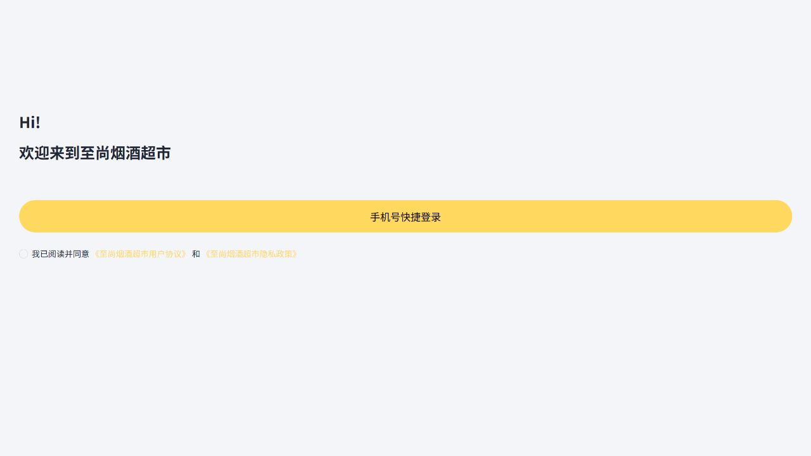
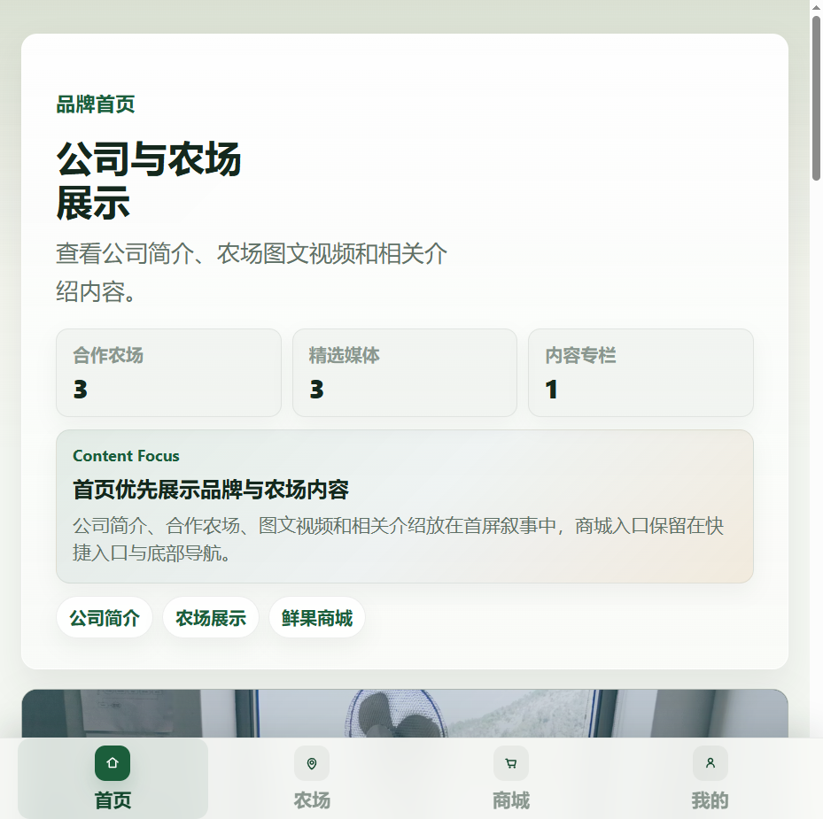
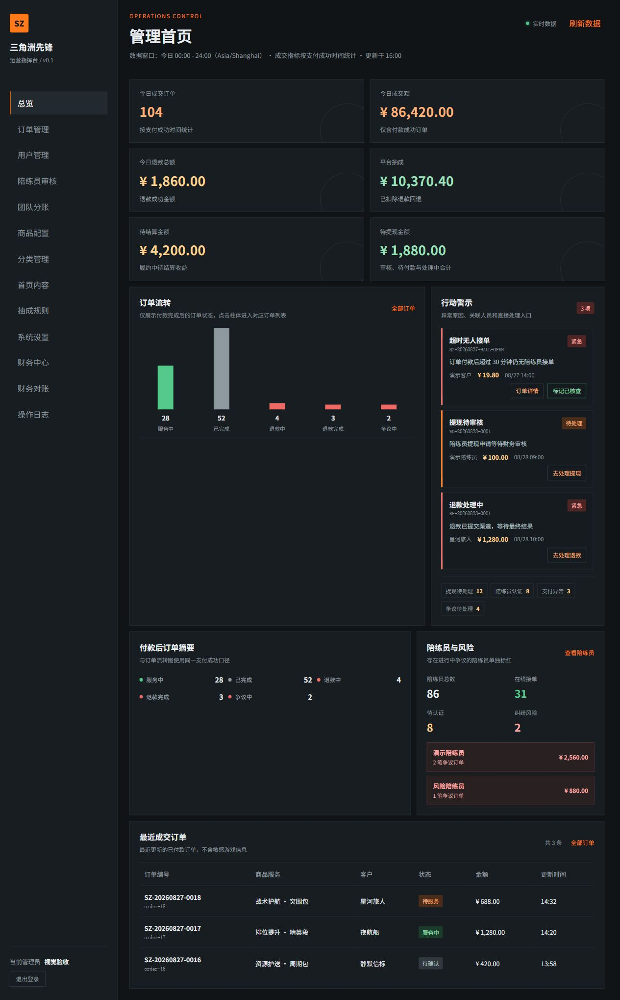
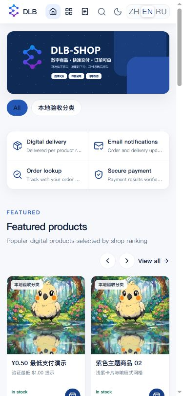
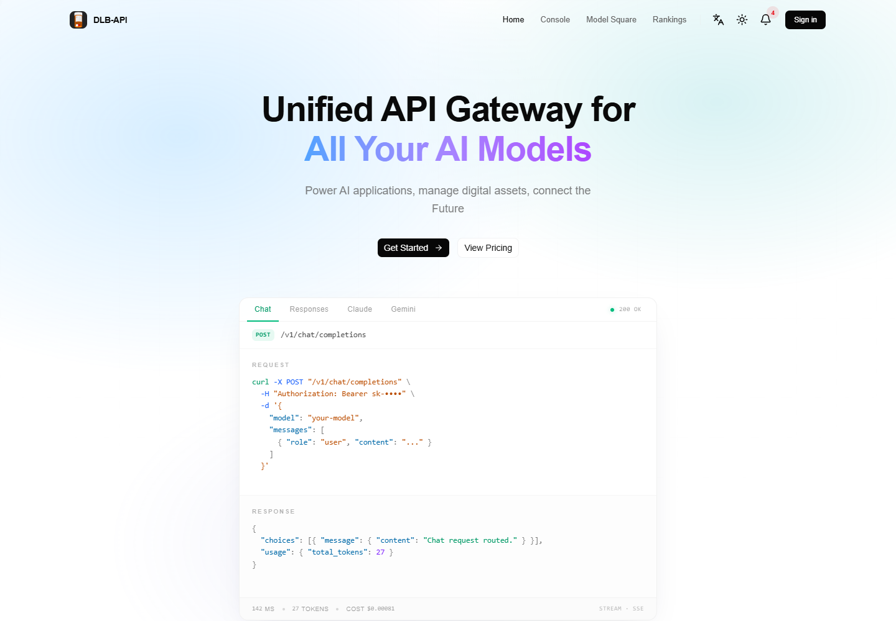

# Le Li — Full-Stack Product Developer

**Live portfolio:** https://elilma.github.io/ai-client-delivery-portfolio/ · **Résumé:** [PDF](assets/le-li-resume.pdf)

I build AI applications, multilingual websites, learning products, and complex client systems. I use Codex to accelerate implementation while keeping architecture, business rules, review, testing, and release accountable to a human.

This repository is the source of truth for both the live portfolio and the GitHub project catalog. The page and this README are generated from the same `projects.json`.


> Real screenshots are used where a usable product image exists. Client code, customer data, credentials, and private screenshots are not published. Projects without a usable screenshot are listed without a fake placeholder image.

<!-- PROJECTS:START -->
## Selected live products

### [Daluobo RAG Support](https://xiaoluobo.cc.cd/)

**Production RAG** · Live

Knowledge-base support with tenant isolation, cited streaming answers, fallback, and human handoff.

Stack: `React` · `TypeScript` · `Cloudflare Workers` · `D1` · `Vectorize`


[Live](https://xiaoluobo.cc.cd/) · [Source](https://github.com/ElilmA/edge-rag-support) · [Case study](case-studies/rag-support.md)

### [RapidSite](https://guanwang.cc.cd/)

**Multilingual website product** · Live

A production website-delivery product with reusable industry templates, content intake, and Cloudflare deployment.

Stack: `TypeScript` · `Vite` · `Cloudflare Pages` · `Cloudflare Workers`


[Live](https://guanwang.cc.cd/) · [Case study](case-studies/rapidsite.md)

### [TenderFit](https://tenderfit.co.uk/)

**Tender discovery** · Live

An explainable tender-discovery product for smaller UK suppliers, with free preview and email-first alerts.

Stack: `Product design` · `Responsive web` · `Cloudflare`


[Live](https://tenderfit.co.uk/) · [Source](https://github.com/ElilmA/tenderfit-uk) · [Case study](case-studies/tenderfit-co-uk.md)

### [PM Forge](https://pm.daluobo.cc.cd/)

**Learning product** · Live · gated

A 12-week product-management learning platform with lessons, templates, exercises, interviews, and progress tracking.

Stack: `Learning design` · `Responsive web` · `Cloudflare Access`


[Live](https://pm.daluobo.cc.cd/) · [Case study](case-studies/pm-forge.md)

## Client systems

### [P4 Parking Reservation](case-studies/parking-reservations.md)

**Reservation operations** · Client delivery

Customer web, mini program, API, and admin workflows for date inventory, pricing, orders, payments, and refunds.

Stack: `React` · `Fastify` · `Prisma` · `PostgreSQL` · `Docker`


[Open project](case-studies/parking-reservations.md)

### [Wadang Workforce](case-studies/workforce-workflows.md)

**Workforce workflows** · Client delivery

Registration, review, points, notifications, and permissions across a mini program, NestJS APIs, and Vue admin.

Stack: `NestJS` · `Vue` · `Prisma` · `PostgreSQL` · `WeChat Mini Program`


[Open project](case-studies/workforce-workflows.md)

### [Jingpai Commerce Platform](case-studies/legacy-commerce.md)

**Legacy enhancement** · Client delivery

Targeted improvements to entitlements, inventory, orders, session access, and signed agreement records.

Stack: `PHP` · `MySQL` · `Redis` · `H5` · `Linux`


[Open project](case-studies/legacy-commerce.md)

### [Zhisheng Commerce Iteration](case-studies/legacy-commerce.md)

**Existing-system iteration** · Client delivery

Product search, homepage configuration, admin maintenance, and data checks across mini-program, Java, and Vue clients.

Stack: `uni-app` · `Vue` · `Java` · `Spring Boot` · `MySQL`



[Open project](case-studies/legacy-commerce.md)

### Liulian Distribution Platform

**Distribution and commerce** · Client delivery

Customer, distribution, order, product, membership, content, and back-office flows for a durian brand platform.

Stack: `NestJS` · `Prisma` · `Redis` · `MinIO` · `WeChat H5`



### Sanjiaozhou Operations Platform

**Operations control** · Platform delivery

Order, refund, finance, companion-review, and operational risk workflows with automated acceptance checks.

Stack: `NestJS` · `PostgreSQL` · `Redis` · `Vue` · `Docker`




## Product and tool projects

### [EdgeKey Digital Shop](https://github.com/ElilmA/edgeKey)

**Cloudflare commerce** · Customized product

A multilingual digital-product storefront with card-key delivery, email notifications, and order lookup.



Stack: `Vike` · `TypeScript` · `Cloudflare Workers` · `D1` · `R2`

[Open project](https://github.com/ElilmA/edgeKey)

### [Daluobo API Relay](https://daluobo.cc.cd/)

**AI infrastructure** · Live

An OpenAI-compatible API gateway that exposes multiple AI models behind one endpoint.



Stack: `API gateway` · `TypeScript` · `Cloudflare` · `OpenAI-compatible API`

[Open project](https://daluobo.cc.cd/)

## Complete project index

| Project | Type | Status | Links |
|---|---|---|---|
| **Daluobo RAG Support** — Knowledge-base support with tenant isolation, cited streaming answers, fallback, and human handoff. | Live | Live | [Live](https://xiaoluobo.cc.cd/) · [Source](https://github.com/ElilmA/edge-rag-support) · [Case](case-studies/rag-support.md) |
| **RapidSite** — A production website-delivery product with reusable industry templates, content intake, and Cloudflare deployment. | Live | Live | [Live](https://guanwang.cc.cd/) · [Case](case-studies/rapidsite.md) |
| **TenderFit** — An explainable tender-discovery product for smaller UK suppliers, with free preview and email-first alerts. | Live | Live | [Live](https://tenderfit.co.uk/) · [Source](https://github.com/ElilmA/tenderfit-uk) · [Case](case-studies/tenderfit-co-uk.md) |
| **PM Forge** — A 12-week product-management learning platform with lessons, templates, exercises, interviews, and progress tracking. | Live | Live · gated | [Live](https://pm.daluobo.cc.cd/) · [Case](case-studies/pm-forge.md) |
| **P4 Parking Reservation** — Customer web, mini program, API, and admin workflows for date inventory, pricing, orders, payments, and refunds. | Client | Client delivery | [Case](case-studies/parking-reservations.md) |
| **Wadang Workforce** — Registration, review, points, notifications, and permissions across a mini program, NestJS APIs, and Vue admin. | Client | Client delivery | [Case](case-studies/workforce-workflows.md) |
| **Jingpai Commerce Platform** — Targeted improvements to entitlements, inventory, orders, session access, and signed agreement records. | Client | Client delivery | [Case](case-studies/legacy-commerce.md) |
| **Zhisheng Commerce Iteration** — Product search, homepage configuration, admin maintenance, and data checks across mini-program, Java, and Vue clients. | Client | Client delivery | [Case](case-studies/legacy-commerce.md) |
| **Liulian Distribution Platform** — Customer, distribution, order, product, membership, content, and back-office flows for a durian brand platform. | Client | Client delivery | — |
| **Sanjiaozhou Operations Platform** — Order, refund, finance, companion-review, and operational risk workflows with automated acceptance checks. | Client | Platform delivery | — |
| **EdgeKey Digital Shop** — A multilingual digital-product storefront with card-key delivery, email notifications, and order lookup. | Tool | Customized product | [Source](https://github.com/ElilmA/edgeKey) |
| **Daluobo API Relay** — An OpenAI-compatible API gateway that exposes multiple AI models behind one endpoint. | Live | Live | [Live](https://daluobo.cc.cd/) · [Source](https://github.com/ElilmA/daluobo) |
| **TomGo Studio** — AI-native UI design, prototyping, code export, and publishing workspace with project history and quotas. | AI product | Working product | — |
| **SellerKit AI** — Text and image generation, asset storage, async jobs, idempotent claims, retries, and failure states. | AI product | Working MVP | — |
| **ReleaseGuard AI** — A browser-based release verification workflow with evidence capture, URL policy, and GitHub webhook boundaries. | AI product | Prototype | — |
| **Career Agent** — A job-search workflow prototype built around deterministic matching, explicit approvals, and idempotent actions. | AI product | Prototype | — |
| **CodeRelay** — A mobile-first remote gateway for Codex and AI coding agents. | Tool | Open source | [Source](https://github.com/ElilmA/CodeRelay) |
| **Xianyu Super Butler** — A customized resale-operations toolkit for listing, fulfillment, reviews, and AI-assisted workflows. | Tool | Customized open source | [Source](https://github.com/ElilmA/xianyu-super-butler) |
| **AI Goofish Monitor** — A Playwright and AI monitoring workflow for multi-task marketplace discovery and analysis. | Tool | Customized open source | [Source](https://github.com/ElilmA/ai-goofish-monitor) |
| **Daily Stock Analysis** — A multi-market data and LLM analysis system with dashboards, news, and scheduled notifications. | Tool | Customized open source | [Source](https://github.com/ElilmA/daily_stock_analysis) |
| **WeChat Intelligence Hub** — A local-first WeChat intelligence workflow with CLI search, daily briefings, and opportunity tracking. | Tool | Customized open source | [Source](https://github.com/ElilmA/wechat-intelligence-hub) |
| **Agent Vision Toolkit** — A visual toolkit for text-only coding agents: image Q&A, long-screenshot OCR, UI restoration, and GUI automation references. | Tool | Customized open source | [Source](https://github.com/ElilmA/agent-vision-toolkit) |
| **Java Order Reliability Lab** — A clean-room Spring Boot lab for idempotency, concurrency, transaction boundaries, and state consistency. | Lab | Open source | [Source](https://github.com/ElilmA/java-order-reliability-lab) · [Case](case-studies/java-order-reliability.md) |
| **Aurora Audio Bars** — A Windows system-audio visualizer with real-time neon energy bars. | Lab | Open source | [Source](https://github.com/ElilmA/aurora-audio-bars) |
| **HelperX** — A desktop utility for academic-resource access support and subscription management. | Lab | Open source | [Source](https://github.com/ElilmA/HelperX) |

## Public repositories

| Repository | Type | Description |
|---|---|---|
| [agent-vision-toolkit](https://github.com/ElilmA/agent-vision-toolkit) | Customized fork | 为纯文本模型"看图“设计更好的视觉工具箱和技能，支持多图理解，图片问答，前端UI还原、GUI 自动化等，并可选无缝接入多个主流agent，直接识别粘贴图片｜ A vision toolkit and skill designed for text-only llms — image Q&A, long-screenshot OCR, frontend UI restoration, and GUI automation, with optional seamless integration for Codex, Claude Code, Pi, Oh My Pi, and OpenCode |
| [ai-client-delivery-portfolio](https://github.com/ElilmA/ai-client-delivery-portfolio) | Original | Sanitized AI-assisted full-stack and RAG client delivery case studies |
| [ai-goofish-monitor](https://github.com/ElilmA/ai-goofish-monitor) | Customized fork | 基于 Playwright 和AI实现的闲鱼多任务实时/定时监控与智能分析系统，配备了功能完善的后台管理UI。帮助用户从闲鱼海量商品中，找到心仪产品。 |
| [ARTEX](https://github.com/ElilmA/ARTEX) | Customized fork | ARTEX 源码备份：基于 Autumn-27/ARTEX v0.3.15，保留原始提交历史与 AGPL-3.0 许可证。 |
| [artex2](https://github.com/ElilmA/artex2) | Customized fork | ARTEX · AI autonomous penetration testing system (multi-agent LLM, Go + Next.js) · AI 自主渗透测试系统 · 百度 agent+ 攻防挑战赛冠军 |
| [aurora-audio-bars](https://github.com/ElilmA/aurora-audio-bars) | Original | Windows system audio aurora visualizer: neon gradient energy bars growing from screen edges, 60fps real-time |
| [clicodelog](https://github.com/ElilmA/clicodelog) | Customized fork | Browse & Inspect CLI agents : Claude Code, Codex, Gemini CLI code & conversation history |
| [CodeRelay](https://github.com/ElilmA/CodeRelay) | Original | Mobile-first remote gateway for Codex and AI coding agents. |
| [daily_stock_analysis](https://github.com/ElilmA/daily_stock_analysis) | Customized fork | LLM 驱动的多市场股票智能分析系统：多源行情、实时新闻、决策看板与自动推送，支持零成本定时运行。  LLM-powered multi-market stock analysis system with multi-source market data, real-time news, decision dashboard, automated notifications, and cost-free scheduled runs. |
| [daluobo](https://github.com/ElilmA/daluobo) | Original | 大萝卜 · OpenAI 兼容 AI 模型中转站：GPT-5.5 / Claude / Gemini / DeepSeek 统一 API，注册送体验额度、每日签到送额度 |
| [daluobo-api-examples](https://github.com/ElilmA/daluobo-api-examples) | Original | 大萝卜 API 接入示例：低价 OpenAI 兼容 AI API 中转站（GPT / Claude / Gemini / DeepSeek），curl / Python / Node.js 快速上手 |
| [detla](https://github.com/ElilmA/detla) | Customized fork | 三角洲护航小程序源码分享 使用springboot + vue +uniapp 开发 ，支持微信小程序， 支持唤起微信支付 |
| [dopamine-core](https://github.com/ElilmA/dopamine-core) | Customized fork | Synthetic dopamine reward signals for AI agents — make them actually want to make money, not just follow instructions. |
| [edge-rag-support](https://github.com/ElilmA/edge-rag-support) | Original | Multi-tenant Cloudflare RAG support SaaS with tenant isolation, citations, queues, D1, R2, Vectorize and 59 tests |
| [edgeKey](https://github.com/ElilmA/edgeKey) | Customized fork | 基于 Vike 驱动的全栈卡密商城系统，一键部署至 Cloudflare Workers。\| A Vike-powered full-stack digital shop, one-click deploy to Cloudflare Workers. |
| [ElilmA](https://github.com/ElilmA/ElilmA) | Original | ElilmA · 大萝卜 DLB-API 作者主页 |
| [Fluent-Steam-Lua](https://github.com/ElilmA/Fluent-Steam-Lua) | Customized fork | 基于 WPF + Fluent Design 开发的现代化轻量级 Steam Lua 入库管理工具，目前仅适配OpenSteamTool |
| [HelperX](https://github.com/ElilmA/HelperX) | Original | 面向科研人员、医务工作者及高校学生的学术资源访问支持、文献检索辅助、期刊资料访问体验优化与客户端订阅管理工具。 |
| [holo-card-studio](https://github.com/ElilmA/holo-card-studio) | Customized fork | Turn the user's description or uploaded reference into a finished, editable Blender card and an interactive Three.js page. Preserve the requested subject, style, typography and destination. This skill contains code and text only; generated artwork belongs in the user's output project. |
| [java-order-reliability-lab](https://github.com/ElilmA/java-order-reliability-lab) | Original | Clean-room Spring Boot case study for order idempotency, concurrency, and transaction consistency |
| [rubyworld](https://github.com/ElilmA/rubyworld) | Customized fork | Realtime online 2D game world. Built with Cloudflare Durable Objects & Pages, React, and Typescript. Inspired by Pokémon Ruby. |
| [SteamManifestGrabber](https://github.com/ElilmA/SteamManifestGrabber) | Customized fork | Steam 清单入库提取工具。 |
| [tenderfit-uk](https://github.com/ElilmA/tenderfit-uk) | Original | Explainable UK tender intelligence with deterministic eligibility gates, Cloudflare Workers and 58 tests |
| [warp-clash-api](https://github.com/ElilmA/warp-clash-api) | Customized fork | No description |
| [Web-Crawling-Stock-Data-](https://github.com/ElilmA/Web-Crawling-Stock-Data-) | Customized fork | 东方财富网股票数据爬取 |
| [wechat-intelligence-hub](https://github.com/ElilmA/wechat-intelligence-hub) | Customized fork | Local-first WeChat intelligence system with a read-only CLI, Codex skills, searchable chat history, daily briefings, follow-ups and opportunity tracking. |
| [Windows-Copilot-API](https://github.com/ElilmA/Windows-Copilot-API) | Customized fork | Reverse engineered Windows Copilot into an OpenAI-compatible API. Access GPT-4 and GPT-5 models through a simple REST interface without API keys or billing. |
| [xianyu-super-butler](https://github.com/ElilmA/xianyu-super-butler) | Customized fork | 闲鱼超级管家是在 xianyu-auto-reply 基础上全面升级的新版本，自动滑块、发货、评价、要花、擦亮通通稳定支持，时刻维护！时刻更新！坚决保证使用世界上最强 AI模型(5.6 sol 、ops 5)进行vibecoding！ |
<!-- PROJECTS:END -->

## How I use Codex

1. **Define the contract.** Convert the request into acceptance criteria, roles, data/API/UI tasks, edge cases, and a testable first milestone.
2. **Give the AI context.** Point it at the relevant pages, APIs, schemas, migrations, and call chains so it reasons about the existing system.
3. **Delegate bounded implementation.** Use Codex for navigation, repetitive edits, implementation drafts, and test scaffolding one slice at a time.
4. **Review the risky parts myself.** Check authorization, amounts, inventory, transactions, idempotency, duplicate submissions, data exposure, and state transitions.
5. **Prove the result.** Exercise happy and failure paths, inspect logs and SQL, test across clients, verify deployment, and leave setup and handoff notes.

## Working with me

I work best with a repository or existing application, a concrete outcome, and observable acceptance criteria. I can begin with a small diagnostic or first milestone, show a working demo early, and leave the code and setup notes ready for the next developer.

## Maintain the portfolio

Edit `projects.json`, then run:

```bash
python scripts/build_portfolio.py
```

This regenerates the project sections in `index.html` and `README.md`, plus `projects-data.js`. Public repository metadata lives in `repositories.json`.
