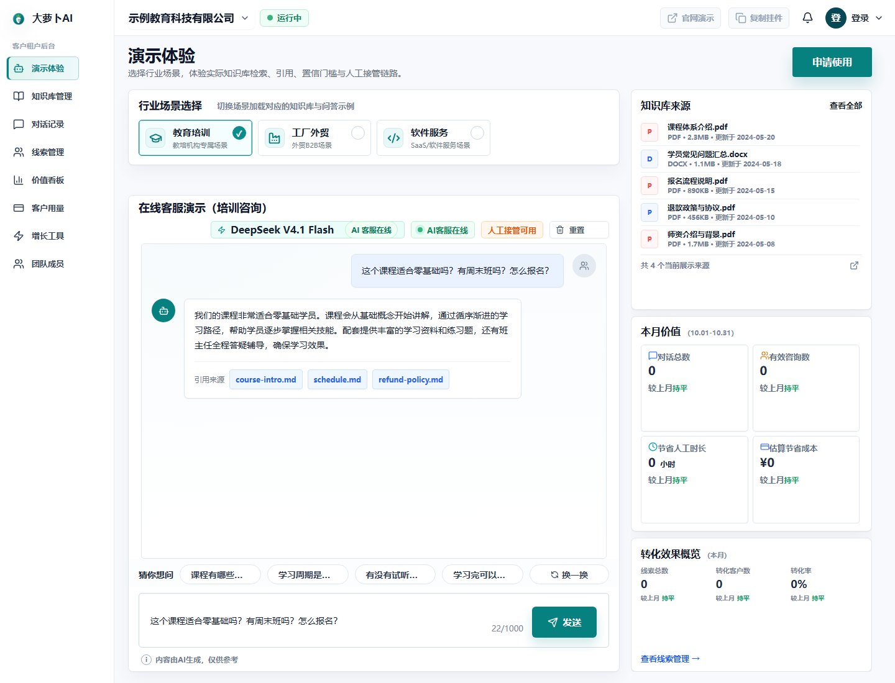
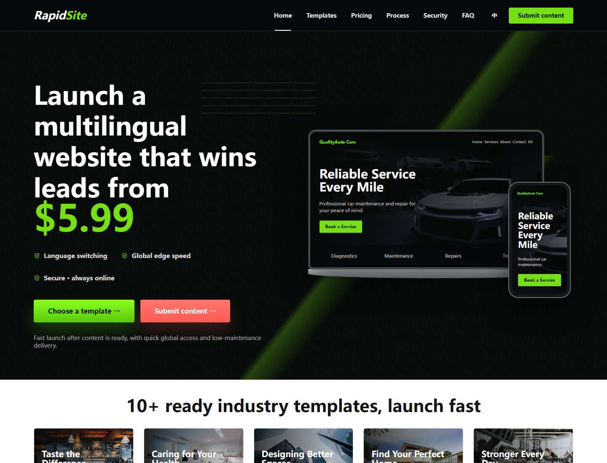
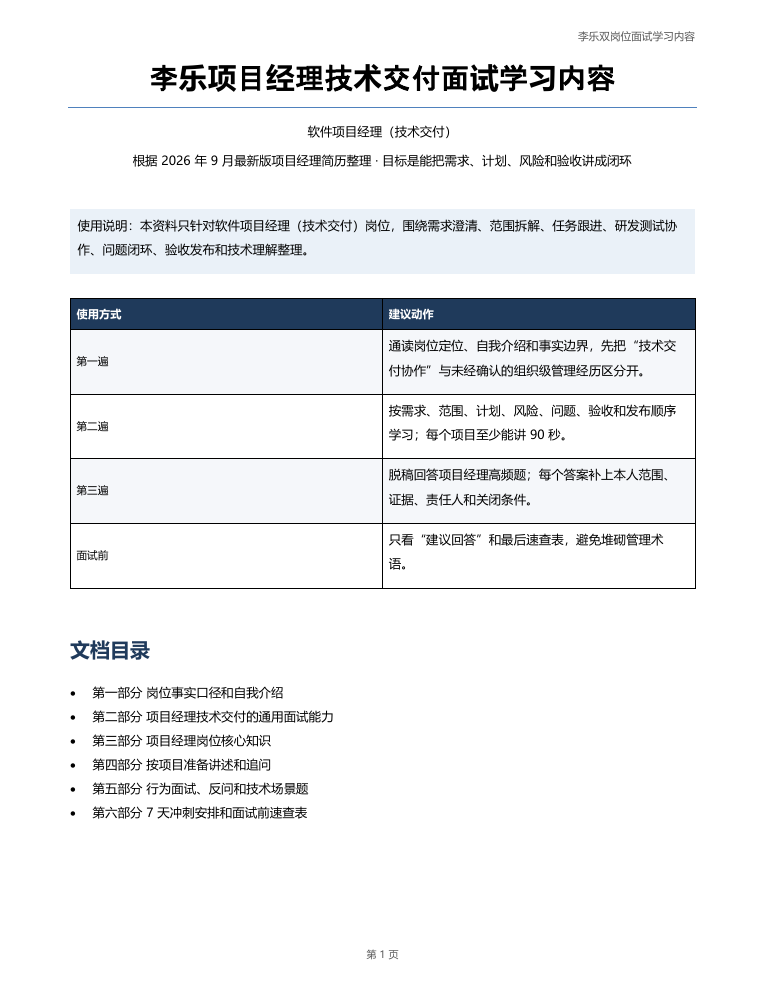
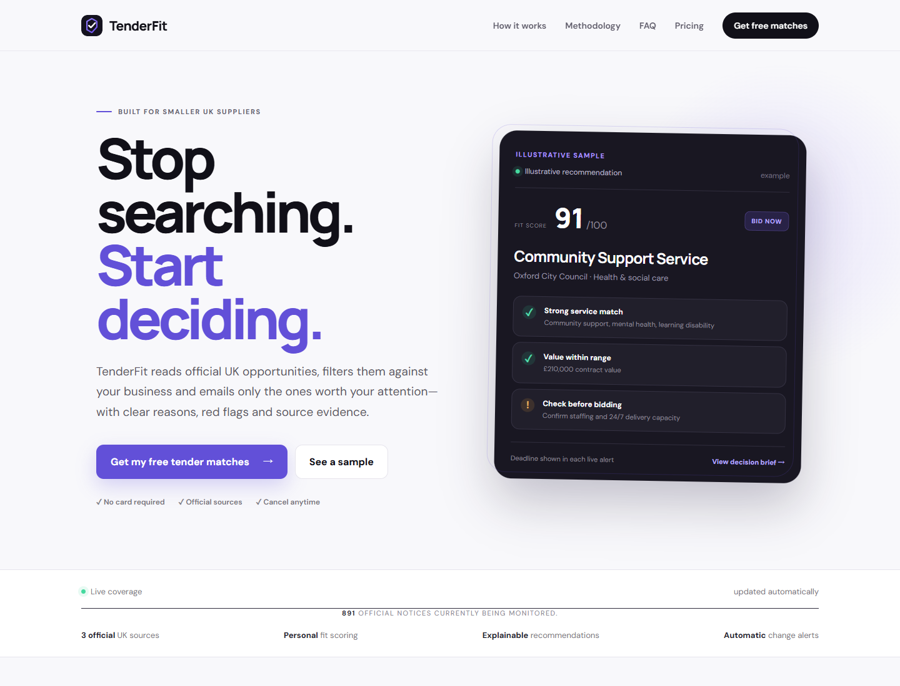
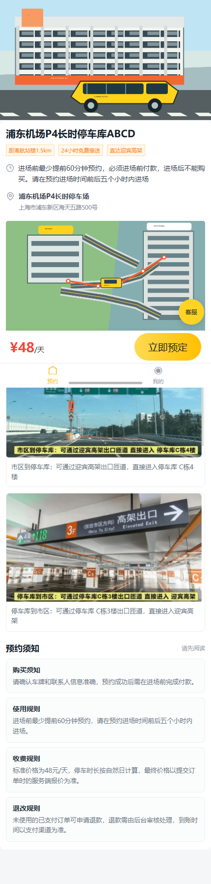
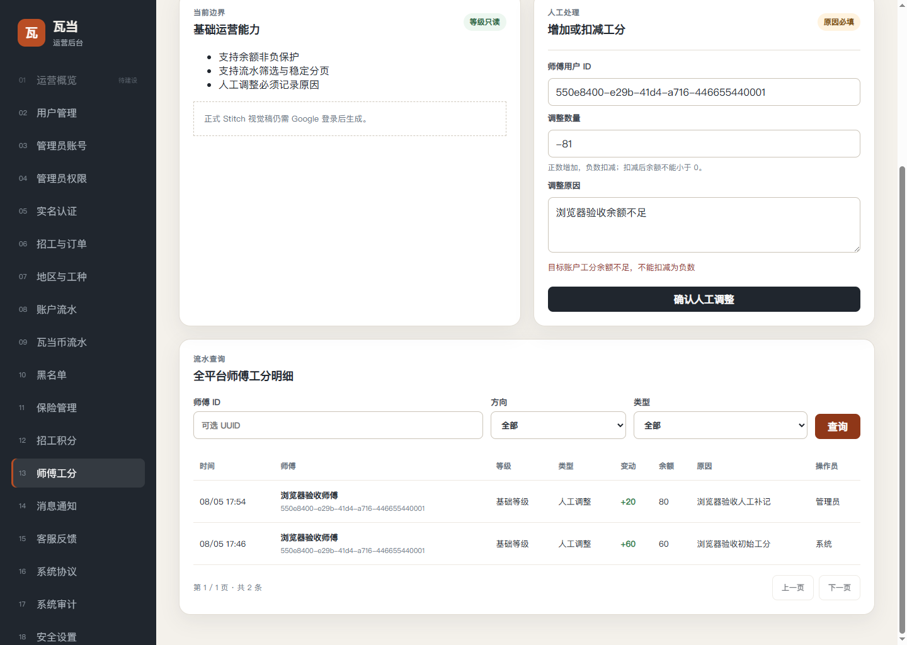
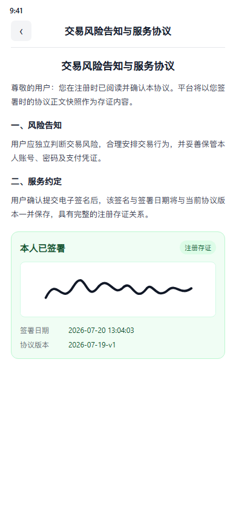

# AI-Assisted Client Delivery Portfolio

**Codex-accelerated full-stack delivery for production web apps, multi-client systems, and AI features.**

I am a full-stack developer with approximately five years of Java and TypeScript experience. I use Codex to inspect existing code, draft scoped implementation work, and accelerate repetitive engineering tasks. I remain responsible for requirements, architecture, code review, business rules, testing, deployment, and handoff.

These case studies are **sanitized**. Private client code, credentials, internal screenshots, customer data, and proprietary assets are not included. Public demos and source links appear only where publication is allowed.

## Live products

### Daluobo RAG Support

Production knowledge-base support with tenant-scoped retrieval, cited streaming answers, fallback, and human handoff.

**Live:** [xiaoluobo.cc.cd](https://xiaoluobo.cc.cd/)

### RapidSite Multilingual Website Product

Production website delivery product with multilingual templates, content intake, and Cloudflare deployment.

**Live:** [guanwang.cc.cd](https://guanwang.cc.cd/)

### PM Forge Learning Hub

An email-gated 12-week product-management learning platform with structured lessons, templates, exercises, interview practice, and progress tracking.

**Live:** [pm.daluobo.cc.cd](https://pm.daluobo.cc.cd/)

The live application is protected by Cloudflare Access. The preview below is from the product's course material.

### TenderFit

A live tender-discovery product for smaller UK suppliers, with explainable matching, free preview, pricing, and source-linked opportunity recommendations.

**Live:** [tenderfit.co.uk](https://tenderfit.co.uk/)

## What I can deliver

- **AI features for existing applications:** model API integration, RAG, citations, streaming responses, structured output, fallback logic, and human handoff.
- **AI-native MVP development:** turn a rough brief or unfinished prototype into a tested, deployable workflow.
- **Full-stack product delivery:** React/Vue interfaces, Java/Node APIs, PostgreSQL/MySQL, admin tools, mini programs, migrations, and Docker deployment.
- **Existing-codebase rescue:** understand the current architecture, isolate the failing workflow, make a bounded change, and verify it across clients and failure paths.

## Case studies

### Live Product: Daluobo RAG Support

[Open the live product](https://xiaoluobo.cc.cd/) · [Read the RAG case study](case-studies/rag-support.md)

### Live Product: RapidSite Multilingual Website Product

[Open the live product](https://guanwang.cc.cd/) · [Read the RapidSite case study](case-studies/rapidsite.md)

### Live Product: PM Forge Learning Hub

[Open the live product](https://pm.daluobo.cc.cd/) · [Read the PM Forge case study](case-studies/pm-forge.md)

### Live Product: TenderFit

[Open the live product](https://tenderfit.co.uk/) · [Read the TenderFit case study](case-studies/tenderfit-co-uk.md)

### 1. Production RAG Support with Citations

Production knowledge-base support application with tenant-scoped retrieval, keyword fallback, cited streaming answers, model fallback, and human handoff.

**Evidence:** [public demo](https://xiaoluobo.cc.cd/) · [public source](https://github.com/ElilmA/edge-rag-support)

[Read the case study](case-studies/rag-support.md)

### 2. Multi-Client Parking Reservation and Operations

Client-cloud delivery across a customer web app, WeChat mini program, API, and operations console, with server-side inventory, pricing, order-state, duplicate-request, and refund checks.

**Evidence:** sanitized case study; private client code and data are not published.

[Read the case study](case-studies/parking-reservations.md)

### 3. Workforce and Project Collaboration

AI-assisted delivery across a mini program, NestJS APIs, and a Vue admin console for registration, review, points, permissions, idempotency, and release verification.

**Evidence:** sanitized case study; private client code and data are not published.

[Read the case study](case-studies/workforce-workflows.md)

### 4. Legacy Commerce Reliability

Targeted improvements to existing commerce systems covering entitlements, inventory, orders, session access, configuration, product search, admin workflows, and SQL verification.

**Evidence:** sanitized case studies; existing client systems and internal data are not published.

[Read the case study](case-studies/legacy-commerce.md)

### 5. Java Order Reliability Lab

Clean-room Spring Boot case study for order idempotency, concurrency, transaction boundaries, and state consistency. No UI screenshot is reused because this project is a backend reliability lab rather than an interface product.

**Evidence:** [public source](https://github.com/ElilmA/java-order-reliability-lab)

[Read the case study](case-studies/java-order-reliability.md)

## How I use Codex

1. **Define the contract.** Convert the request into acceptance criteria, data/API/UI tasks, permissions, edge cases, and a testable first milestone.
2. **Give the AI context.** Point it at the relevant pages, APIs, schemas, migrations, and call chains so it reasons about the existing system instead of inventing a new one.
3. **Delegate bounded implementation.** Use Codex for codebase navigation, repetitive edits, implementation drafts, and test scaffolding one vertical slice at a time.
4. **Review the risky parts myself.** Check authorization, amounts, inventory, transactions, idempotency, duplicate submissions, data exposure, and state transitions.
5. **Prove the result.** Exercise happy and failure paths, inspect logs and SQL, test across clients, verify deployment, and leave setup and handoff notes.

## Additional client delivery experience

The wider delivery background includes order, complaint, invoice, payment, refund, withdrawal, booking, inventory, approval, attachment, entitlement, and admin workflows across Java/Spring Boot, Vue, React, TypeScript, WeChat Mini Programs, MySQL, PostgreSQL, Redis, and Docker Compose.

Client names and proprietary modules are omitted from this public portfolio. Detailed walkthroughs can be provided under an appropriate NDA or during a client conversation.

## Technology

`TypeScript` `JavaScript` `React` `Vue` `Node.js` `NestJS` `Fastify` `Java` `Spring Boot` `MyBatis` `PostgreSQL` `MySQL` `Redis` `Prisma` `Cloudflare Workers` `D1` `R2` `Vectorize` `Workers AI` `OpenAI API` `Docker Compose`

## Work with me through Upwork

I work best with a repository or existing application, a concrete outcome, and observable acceptance criteria. I can begin with a small diagnostic or first milestone, show a working demo early, and leave the code and setup notes ready for the next developer.

This repository is a portfolio index, not an offer of client source code. All client work shown here is paraphrased and sanitized for confidentiality.
