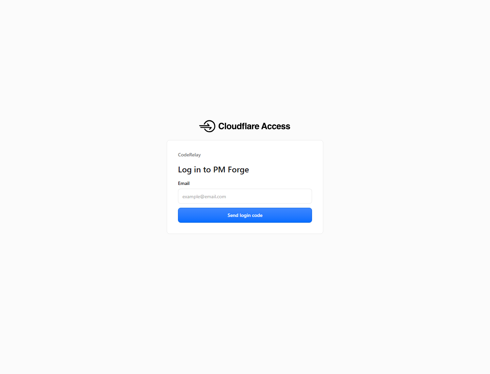

# PM Forge Learning Hub

**Live product:** https://pm.daluobo.cc.cd/  
**Access:** Email-gated Cloudflare Access application  
**Role:** Product and full-stack developer  
**Focus:** Product-management learning experience, structured curriculum, and progress tracking

## Product

PM Forge is a private-beta learning platform for technical and B2B product managers. It organizes a 12-week practice curriculum around product discovery, requirements, workflows and permissions, prototyping, metrics, technical collaboration, roadmap delivery, launch operations, SaaS strategy, interview practice, and portfolio building.

## Learning experience

- Weekly lessons with exercises, examples, review questions, and scoring criteria.
- Reusable templates for product briefs, user research, PRDs, requirement prioritization, metrics, release plans, and retrospectives.
- A structured interview bank and progress tracker.
- A single consistent case study so learners build a coherent portfolio instead of isolated exercises.
- Cloudflare Access protection for the private-beta application.

## What this demonstrates

- Product information architecture and curriculum design.
- Responsive learning-product delivery with authentication-gated access.
- Turning a large body of unstructured knowledge into a repeatable learning workflow.
- AI-assisted implementation with human review of content quality, facts, sequencing, and acceptance criteria.

## Evidence

- [Live product](https://pm.daluobo.cc.cd/) — Cloudflare Access login required.
- [Course preview](../assets/pm-forge-course-preview.png)
