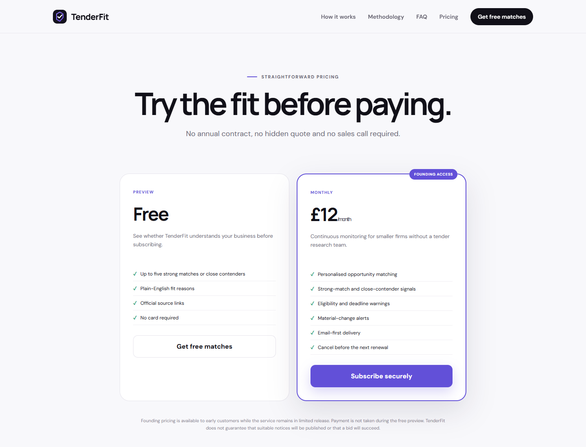

# TenderFit

**Live product:** https://tenderfit.co.uk/  
**Role:** Product and full-stack developer  
**Focus:** Tender discovery, explainable matching, free preview, and email-first alerts

## Product

TenderFit helps smaller UK suppliers stop scanning every tender notice. The live product presents a personalized shortlist with fit signals, warned risks, official source evidence, and a clear next action. Visitors can request a free source-linked preview before deciding whether to subscribe.

## What I built

- Product positioning and English copy for a tender-filtering service.
- A responsive marketing site with a product demonstration, workflow, methodology, FAQ, pricing, free-preview entry, and legal content.
- Clear fit-reason, red-flag, and source-evidence presentation.
- Production deployment on the public `tenderfit.co.uk` domain.
- Live route and content verification after release.

## AI-assisted workflow

The public product was iterated with Codex-assisted implementation: draft page structure and copy, review information hierarchy and responsive states, then verify the deployed routes rather than treating generated output as complete.

## Boundary

The public website presents the product experience and offer. This case does not claim measured matching accuracy, paid customer volume, revenue, or a fully audited procurement methodology.
